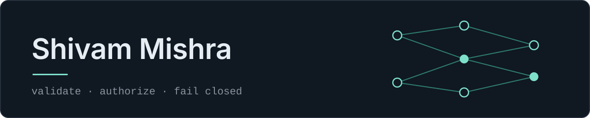

  

**Backend and systems engineer.** I build agent runtimes, backend APIs and applied-ML services. The throughline across all of them: **model output and external input are untrusted** — validate them, authorize every side effect, and fail closed when a guarantee cannot be met.

I'd rather ship a smaller system with tests and a benchmark than a larger one I can't verify — so each repository below states what works, what doesn't, and what wasn't checked.

**B.Tech, Artificial Intelligence** — B. K. Birla Institute of Engineering & Technology, Pilani · expected 2027

`Python` · `TypeScript` · `C++` · `JavaScript` · `SQL`

---

## Flagship

### [AgentOS](https://github.com/ShivamCore/AgentOS) · a local-first agent runner
`Python` `FastAPI` `Celery` `SQLAlchemy/SQLite` `Redis` `Docker` `Ollama` · MIT

You describe a coding task. A local LLM plans it as a dependency graph of small steps. AgentOS then **rejects any plan that fails strict validation rather than repairing it**, runs independent steps concurrently, executes each one through an authorized tool layer inside a fail-closed Docker sandbox, and persists every state transition, log line and file edit.

- **One source of truth for state.** [`NodeStateMachine.transition`](https://github.com/ShivamCore/AgentOS/blob/main/agent/lifecycle.py) is the only definition of legal node and run transitions, and it *raises* on an illegal one — so no code path can invent a state. When a node fails, every transitive dependent becomes `BLOCKED` while independent branches keep running, and a run that finishes some but not all nodes ends as `PARTIAL_SUCCESS`, never `COMPLETED`.
- **Untrusted by design.** [Plan validation](https://github.com/ShivamCore/AgentOS/blob/main/agent/planner/graph.py) rejects cycles, dangling and self dependencies, unknown tools, agents and fields, and size or depth overruns. Tools are re-authorized at execution time against the plan ∩ the agent manifest ∩ a risk level. Commands run with no shell, allow-listed only, in a disposable container with no network — and **if Docker is unavailable, nothing runs at all.**
- **Measured, not asserted.** 16 independent 50 ms steps: 0.863 s at one worker → 0.111 s at eight, a **7.79×** speedup. A 16-step chain gets 1.00×, and a layered graph plateaus at 3.9× because its widest layer — not the worker count — is the real limit. `phi3.5` warm decode median 40.9 tok/s. Raw JSON for both harnesses is committed under [`benchmarks/results/`](https://github.com/ShivamCore/AgentOS/tree/main/benchmarks/results).
- **Evidence.** **287 tests passing** in a clean virtualenv matching CI (288 with the optional memory extra; 9–10 skipped for Docker, opt-in Ollama and one Linux-only rlimit), **76.75%** line-and-branch coverage against a 75% gate, `mypy --strict` clean, five [ADRs](https://github.com/ShivamCore/AgentOS/tree/main/docs/decisions) recording each decision with its consequences, and every CI job green on `main` — `ruff`, `mypy --strict`, the suite, the coverage gate, a multi-arch Docker build with a Trivy image scan, plus CodeQL, Semgrep, Gitleaks and OSV.
- **I audited my own project and published the findings.** The [engineering audit](https://github.com/ShivamCore/AgentOS/blob/main/docs/engineering-audit.md) records 21 defects I found and fixed, with the evidence for each. A 154-test suite passed while the executor path was *entirely mocked*, the mocks returning `dict` where the real function returns `str` — so no task could ever actually complete a step. A `WS /ws/terminal` endpoint ran any received text through `create_subprocess_shell` on the host with no authentication, reachable from the network because `start.sh` bound to `0.0.0.0`. Path confinement used `startswith`, so `/ws-evil` passed as `/ws` and symlinks escaped the workspace entirely. A set of performance claims had no measurement behind them, and I deleted them rather than defend them. The [security model](https://github.com/ShivamCore/AgentOS/blob/main/docs/security.md) names what is still open, including the one sandbox property not yet demonstrated against a real daemon. I would rather hand a reviewer that list than have them find it.

---

## Selected projects

### xTalAI · grounded question answering for crystallography
`Python` `FastAPI` `BM25` `embeddings` `re-ranking` · private repository, walkthrough on request

A citation-grounded QA service over **358 expert crystallography Q&A records**. Every sentence it returns carries a valid citation — **261 of 261** on the test set — and when retrieval confidence is low it **abstains instead of answering**, a decision that separates answerable from unanswerable questions at **0.976 AUROC**.

- **The evaluation harness is the project.** A held-out 138-question test set with bootstrap confidence intervals, used to compare **16 retrieval configurations** end to end rather than tuning against a single score. Decision accuracy went from **0.70 to 0.79** over the legacy system, and **0.86** with re-ranking.
- **Negative results are reported, not buried.** Hybrid RRF and a local LLM were both evaluated and neither gave a gain — written down next to the wins instead of dropped. The held-out set is LLM-labelled, and the evaluation says so rather than presenting the numbers as settled.
- **Shipped behind a REST API** (FastAPI) with **537 passing tests** and CI gates for lint, type checks and *exact* benchmark reproduction — a changed number fails the build.

### [AssetFlow](https://github.com/ShivamCore/Asset-Flow) · asset and resource management
`Python` `FastAPI` `SQLAlchemy 2` `Pydantic v2` `Next.js (App Router)` `TanStack Query`

A team ERP built for **Odoo Hackathon 2026, where it qualified for the final round** — 27 commits in one day across three committers. My share, by `git log` per directory, is the booking, maintenance and audit APIs plus the other workflow modules (notifications, activity log, dashboard, reports), their tests, the Next.js frontend, and the app integration.

- **Modules that could be built in parallel.** Each is a vertical slice with the same internal shape — `router` / `service` / `validators` / `schemas` / `models` — and **none imports another module's ORM models**. Modules that need assets reach them only through an `AssetGateway` over a minimal four-field contract. That boundary is why three people could work simultaneously without blocking each other, and why the modules stay independently testable.
- **The bug the design is really about.** Double booking: `booking/service.py` rejects any active booking on the same asset whose window overlaps `[start, end)` — checked on create *and* on reschedule, not just the former.
- **Evidence.** **191 backend tests passing** across the seven modules plus cross-module integration, verified in a clean virtualenv.
- **The schema conflict is resolved.** Two halves of the backend owned the same `assets` table with different shapes — an integer key on one side, the string ids (`AST-0001`) the gateway contract and the UI use on the other — so the app died at startup seeding the demo estate. They now agree on one schema: string key, shared `department_id`, one lower-case status vocabulary, and `server_default`s on the shared columns, because a table written through two layers needs its invariants in the schema rather than in one ORM. Authentication is still a demo seam rather than real security, and the README says so — but the application now boots on an empty database, seeds sixteen assets, and books one end to end, with the overlapping request refused and an unknown asset id rejected by the gateway.

---

## Foundations

### [Python](https://github.com/ShivamCore/Python) · applied machine learning
`scikit-learn` `TensorFlow/Keras` `Flask` `pandas` `Jupyter`

End-to-end mini-projects rather than notebook fragments: explore and clean a dataset, train a model, commit the artifact, and serve predictions from a Flask app — so each one runs without retraining. The committed `model.joblib` files for the crop, insurance, laptop and bike projects were each loaded in a clean environment and confirmed to be fitted estimators with a working `predict`.

The most substantial piece is a **risk-based authentication** study: a Flask app over three separately trained pipelines (login, attack and round-trip-time, each with its own scaler, feature selector and estimator), plus a [reproduction of published RBA results](https://github.com/ShivamCore/Python/blob/main/PROJECTS/Login%20Detector/login/RESULTS.md) — re-authentication rates by attacker type and Dunn–Bonferroni significance tables over RTT distributions by country and region. The README is explicit that the models are small decision trees chosen for transparency, and claims no accuracy figures beyond what each notebook shows.

### [Cpp](https://github.com/ShivamCore/Cpp) · C++ fundamentals
`C++17` `STL` `std::thread` `fstream` `Qt`

Compile status is checked file by file and reported: **all 85 console programs build cleanly** under `g++ -std=c++17`. Six did not — a legacy `void main()`, two files carrying a second `main` from keeping both solutions side by side, a `default:` label orphaned when a `switch` became an `if`/`else` chain, a seven-character string in a six-byte array, and one stray character — each diagnosed, fixed and then run to confirm the behaviour, not just the build. Underneath that: language fundamentals through OOP, the STL, pointers, file handling and `std::thread`, two Qt desktop applications, and a console records system on binary `fstream` with a recoverable trash file.

---

## Stack

| Area | In use |
|---|---|
| **Languages** | Python, C++17, TypeScript, JavaScript, SQL |
| **CS fundamentals** | Data structures, algorithms, object-oriented design, DBMS, operating systems, networking |
| **Backend & APIs** | REST API design, FastAPI, Celery, Node.js, SQLAlchemy 2, Pydantic v2, PostgreSQL, SQLite, Redis |
| **Frontend** | Next.js App Router, React, TanStack Query, Tailwind |
| **AI / ML** | Retrieval (BM25, embeddings, re-ranking), held-out evaluation with bootstrap CIs and abstention gates, local LLM inference (Ollama — typed errors, bounded retries, streaming, JSON mode), scikit-learn, TensorFlow/Keras, Flask model serving |
| **Systems & security** | Docker, Docker Compose, container sandboxing, allow-listed command execution, workspace path confinement, dependency and code scanning |
| **Tooling** | Git, Linux, GitHub Actions (CI/CD), pytest, `ruff`, `black`, `mypy --strict`, CodeQL, `pip-audit`, ADRs, reproducible benchmarks |

---

## Contact

[LinkedIn](https://www.linkedin.com/in/shivamm-mishraa/) · [soulshivam77@gmail.com](mailto:soulshivam77@gmail.com) · open to backend, systems and AI/ML engineering roles and internships.
